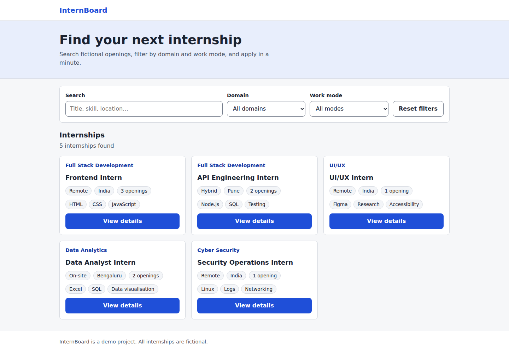
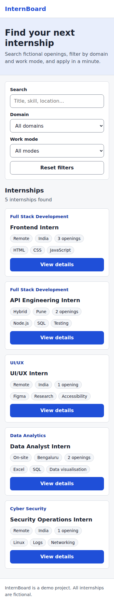

# InternBoard — Responsive Internship Board

An accessible, responsive student internship board. Users can search, filter by domain and work mode, open a details dialog, and submit an application. Front end is plain HTML/CSS/JavaScript; the API is a small dependency-free Node.js server.

- **Repository:** `<ADD GITHUB REPO URL>`
- **Live site:** `<ADD DEPLOYED URL>`
- **Two-minute walkthrough:** `<ADD VIDEO URL>`




## Problem
Students need a quick way to find relevant internships without a heavy site. This board works with keyboard, touch, and screen readers from 320px to desktop.

## Features
- Search (title, skills, domain, mode, location, ID) — case-insensitive, partial, whitespace-trimmed
- Domain and work-mode filters built from the actual data; reset button
- Paginated list with live result count
- Loading, empty, error and **Retry** states (empty results are never shown as errors)
- Details dialog (native `<dialog>`) with an application form
- Server-side validation: missing name, invalid email, unsafe URLs, duplicate applications
- Logs contain only method, path (no query string), status and timing

## Tech
HTML5, CSS3, vanilla JS, Node.js ≥ 18 (built-ins only — no npm dependencies, no framework).

## Structure
```
server.js              API + static file server
docs/index.html        page (folder is named docs/ so GitHub Pages can serve it)
docs/css/styles.css    mobile-first styles
docs/js/app.js         fetch, render, filters, dialog, form
docs/data/internships.json  supplied seed (unchanged, IDs preserved) — single copy
data/applications.json created at runtime (git-ignored)
scripts/seed.js        validates seed, resets applications store
test/api.test.js       API tests (node:test)
test/browser_test.py   browser tests (Playwright)
screenshots/           real screenshots from the running app
```

## Run locally
```bash
npm run seed     # validate seed + create empty applications store
npm start        # http://localhost:3000
npm test         # API tests
```
Environment variables (see `.env.example`; no secrets): `PORT`, optional `APPLICATIONS_FILE`.

## API
All responses use an envelope: `{ "status": "success" | "error", ... }`.

| Method & path | Notes |
|---|---|
| `GET /api/internships?q=&domain=&mode=&page=1&limit=6` | `{status, data:[…], pagination:{page,limit,total,totalPages}}`; `limit` 1–50 |
| `GET /api/filters` | `{status, data:{domains:[…], modes:[…]}}` |
| `POST /api/applications` | JSON `{internshipId, name, email, portfolioUrl?}` → `201` / `404` / `409 DUPLICATE_APPLICATION` / `422 VALIDATION_FAILED` (with `error.fields`) / `400` / `413` / `415` |

Errors: `{status:"error", error:{code, message, fields?}}`.
The brief did not define endpoint paths, so these are my own; the envelope follows the brief.

**Schema.** Seed records keep their original fields: `id, title, domain, mode, location, skills[], openings`. Applications: `id (uuid), internshipId, name, email (lowercased), portfolioUrl, createdAt`. Duplicate = same `internshipId` + email.

## Accessibility
Semantic header/main/section/footer; one `h1`, no skipped levels; every control has a visible `<label>`; skip link; visible focus ring; `role="status"` live region for result count; dialog is native (focus trap, Esc, focus returns to trigger); field errors use `aria-invalid` + `aria-describedby` and text (not colour alone); 44px minimum touch targets; reduced-motion respected.

## Responsive behaviour
Mobile-first: 1 column under 640px, 2 at ≥640px, 3 at ≥1024px; filters stack on small screens; long text wraps.

## Two modes
- **Full mode** (`npm start`): API search/filter/pagination and application submission.
- **Static mode** (GitHub Pages): no API exists, so the page detects a non-API response and loads `docs/data/internships.json`, applying the same search/filter rules in the browser. Browsing works; applications are **disabled** with a message, because there is no server to validate and store them. A genuine network failure still shows the error state with Retry. On static hosts the browser console shows one expected 404 for `api/…` before the fallback.

## Test results (run on 22 Oct 2026, Chromium via Playwright)
- `npm test`: **18/18** API tests passed.
- `python3 test/browser_test.py`: **82/82** browser checks passed — rendering, search, filters, reset, keyboard-only dialog + form, validation, duplicate handling, error/retry, empty dataset, malformed records, XSS strings rendered as text, no horizontal overflow at 320/360/375/480/768/1024/1440px, touch targets, dialog fit, heading/label/focus checks, axe-core 0 violations at 360px (list and dialog open), and a GitHub-Pages-style run (plain static server, served from a sub-path) at 320/375/768/1024/1440px.
- Not verified: real screen readers (NVDA/VoiceOver), Firefox/Safari, real mobile devices, the actually deployed site.

Run browser tests: `pip install playwright && python3 -m playwright install chromium && python3 test/browser_test.py --screenshots` (optional `AXE_PATH=…/axe.min.js` from `npm i axe-core`). Playwright runs with CSP bypass because it evaluates strings; the app itself serves a strict CSP.

## Deployment
**GitHub Pages (static, browse-only):** push to GitHub → repo *Settings → Pages* → Source: *Deploy from a branch* → Branch `main`, folder `/docs` → Save. After ~1 minute the site is at `https://<user>.github.io/<repo>/`. All asset and data paths are relative, so the sub-path works.

**Full app with applications:** deploy as a Node web service (e.g. Render): Build command empty, Start command `npm start`. Free hosts may reset `data/applications.json` on restart — fine for a demo.

```bash
git init && git add . && git commit -m "Responsive internship board"
git branch -M main
git remote add origin <YOUR_REPO_URL>
git push -u origin main
```
